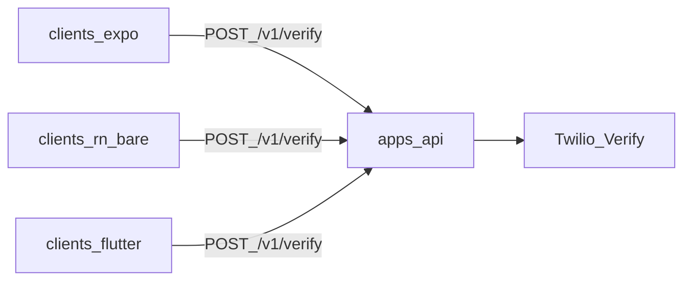

# Architecture

## Responsibilities

| Layer | Responsibility |
|-------|----------------|
| Clients | Collect phone + OTP, call HTTP API, map `error.code` to UI |
| `apps/api` | Validate E.164, rate-limit, call Twilio Verify, stable JSON envelope |
| Twilio Verify | Send SMS OTP and check codes |

Clients never hold Twilio credentials. Only the API uses Account SID, Auth Token, and Verify Service SID.

## Flow

1. Client `POST /v1/verify/start` with E.164 phone.
2. API normalizes phone, applies rate limits, creates a Verify verification (`channel: sms`).
3. User receives SMS; client shows OTP screen.
4. Client `POST /v1/verify/check` with phone + code.
5. API creates a verification check; returns `approved` or `INVALID_CODE`.

Optional: Twilio status callbacks → `POST /v1/webhooks/twilio` (signature validated when `PUBLIC_API_URL` is set).

## Copy-paste model

Each client folder is self-contained. New developers copy listed source files into an existing Expo, bare RN, or Flutter app and point env at the API. See the root [README](../README.md).
